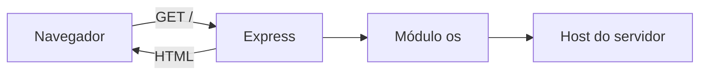

# ☁️ SO Cloud App — Monitor de Sistemas Operacionais

Aplicação web didática em **Node.js com Express** que exibe informações básicas da máquina que executa o servidor. O objetivo é demonstrar como obter dados do sistema operacional com o módulo nativo `os` do Node.js.

[](https://nodejs.org/) [](https://expressjs.com/)

## 📌 Como funciona

Uma requisição `GET /` aciona a função do servidor, consulta o módulo `os` e retorna uma página HTML com os valores atuais. **A página não se atualiza continuamente**; recarregue-a para fazer uma nova consulta.



## ✨ Informações apresentadas

| Campo | API utilizada |
|---|---|
| Hostname | `os.hostname()` |
| Plataforma | `os.platform()` |
| Arquitetura | `os.arch()` |
| Memória total | `os.totalmem()` |
| Memória livre | `os.freemem()` |
| Quantidade de CPUs | `os.cpus().length` |
| Tempo de atividade | `os.uptime()` |

A memória é exibida com o rótulo MB após a divisão por `1024²`; o tempo de atividade é arredondado em minutos.

## 📂 Arquivos do projeto

| Arquivo | Finalidade |
|---|---|
| [cloud-so-app.js](cloud-so-app.js) | Servidor Express e geração da página HTML |
| [package.json](package.json) | Dependências `express` (`^5.2.1`) e `cors` (`^2.8.6`) |
| [package-lock.json](package-lock.json) | Registro de versões resolvidas pelo npm |

A dependência `cors` está declarada, porém não é utilizada em `cloud-so-app.js`. O repositório também contém `node_modules` versionado, o que não é necessário para executar `npm ci`.

## ⚙️ Instalação e execução

Com Node.js e npm instalados:

```bash
git clone https://github.com/theroven79-droid/SO-CLOUD-APP.git
cd SO-CLOUD-APP
npm ci
node cloud-so-app.js
```

Abra **http://localhost:3000**. É possível configurar outra porta com `PORT`; exemplo em Bash:

```bash
PORT=3002 node cloud-so-app.js
```

O `package.json` não define scripts `start`, `dev` ou `test`, portanto não utilize `npm start` como comando padrão deste projeto.

## 🌐 Endpoint disponível

| Método | Rota | Conteúdo |
|---|---|---|
| `GET` | `/` | Página HTML com indicadores do host |

```bash
curl http://localhost:3000/
```

## ☁️ Hospedagem

Em um serviço Node.js, o comando de instalação pode ser `npm ci` e o de inicialização deve apontar para `node cloud-so-app.js`. O servidor aceita a variável de ambiente `PORT`. Essas são instruções de configuração possíveis, **não uma afirmação de deploy realizado**.

## 🔎 Limitações

- Não há API JSON, banco de dados, autenticação ou atualização automática em tempo real.
- Os indicadores pertencem **ao servidor**, não ao dispositivo do visitante.
- Não existe suíte de testes automatizados definida no manifesto.

**Fonte técnica:** [código do servidor](cloud-so-app.js) · [dependências](package.json) · [API `os` do Node.js](https://nodejs.org/api/os.html).
