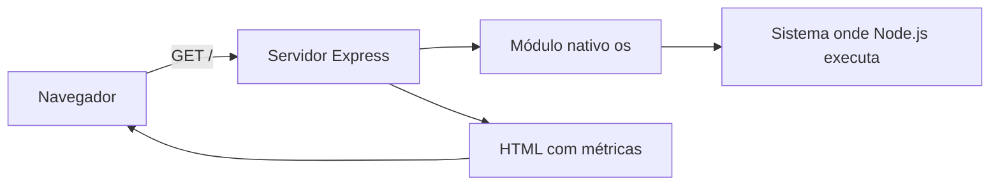

# SO Cloud App — Monitor de Sistemas Operacionais

 


## 🚀 Operação Cloud · Trilha prática

> **Missão:** entender como uma requisição web percorre o Express e consulta o sistema operacional pelo Node.js. Este projeto é uma aplicação pequena com **uma única rota** e leitura de métricas por acesso.

| Nível | Objetivo | Como comprovar | XP simbólico |
|---|---|---|--:|
| 01 · Boot | Inicializar o servidor | `node cloud-so-app.js` | 20 |
| 02 · HTTP | Consultar a rota `/` | `curl http://localhost:3000/` | 20 |
| 03 · Observabilidade | Localizar os campos exibidos | [`cloud-so-app.js`](cloud-so-app.js) | 30 |
| 04 · Cloud | Entender o uso da variável `PORT` | [Código-fonte](cloud-so-app.js) · [Deploy](#publicar-como-serviço-nodejs) | 30 |

**Checklist de validação manual**

- [ ] O processo Node.js inicia sem erros no seu ambiente.
- [ ] A rota `GET /` devolve HTML.
- [ ] O HTML contém hostname, plataforma, arquitetura, memória, CPUs e uptime.
- [ ] Consegui explicar por que a página remota mede o **servidor** e não meu computador.

<details>
<summary><strong>🏆 Missão bônus de melhoria</strong></summary>

**Desafio proposto (não implementado):** criar uma rota `/api/health` que responda JSON, mantendo `GET /` como está. Essa rota **não existe na implementação atual**. Depois, documente no README o contrato real que você implementar.

</details>

**🧠 Fonte de verdade:** [`cloud-so-app.js`](cloud-so-app.js) e [`package.json`](package.json). Pontos e conquistas são uma convenção de estudo, não um recurso de software.

---

Aplicação Node.js com Express que apresenta informações do sistema operacional em uma página HTML. A implementação está no arquivo [cloud-so-app.js](cloud-so-app.js).

Os dados são consultados quando a página é acessada. Para obter uma nova leitura, recarregue a página. As informações pertencem à máquina que executa o servidor Node.js.

## Conteúdo do repositório

| Arquivo | Conteúdo |
| --- | --- |
| [cloud-so-app.js](cloud-so-app.js) | Servidor Express, rota da página e leitura das informações do sistema. |
| [package.json](package.json) | Dependências declaradas: Express e CORS. |
| [package-lock.json](package-lock.json) | Versões das dependências registradas pelo npm. |

## Instalação e execução

Com Node.js e npm disponíveis, execute na raiz do repositório:

```bash
npm ci
node cloud-so-app.js
```

O programa imprime `Servidor rodando` ao iniciar e usa a porta **3000** por padrão. Para definir outra porta em um terminal Bash:

```bash
PORT=3002 node cloud-so-app.js
```

O [package.json](package.json) não define scripts de execução; por isso, o comando de inicialização é `node cloud-so-app.js`.

## Informações da página

A rota `GET /` retorna uma página com o título **Monitor de Sistemas Operacionais** e os seguintes campos:

| Campo | Informação exibida |
| --- | --- |
| Hostname | Nome da máquina, obtido por `os.hostname()`. |
| Plataforma | Plataforma do sistema, obtida por `os.platform()`. |
| Arquitetura | Arquitetura do processo, obtida por `os.arch()`. |
| Memória total | Valor de `os.totalmem()` dividido por 1024², arredondado e exibido com o rótulo MB. |
| Memória livre | Valor de `os.freemem()` dividido por 1024², arredondado e exibido com o rótulo MB. |
| CPUs | Quantidade de entradas retornadas por `os.cpus()`. |
| Uptime | Tempo de atividade do sistema convertido para minutos e arredondado. |

As consultas ao sistema usam o módulo nativo `os` do Node.js. A porta é lida de `process.env.PORT`, com o valor 3000 como padrão.

## Conferir a resposta

Com o processo em execução, faça uma requisição local em outro terminal:

```bash
curl --fail --silent http://127.0.0.1:3000/
```

A resposta deve conter o título do monitor e os campos da tabela. Se tiver definido outra porta, ajuste o comando.

## Observações

- O pacote CORS está declarado como dependência, mas não é utilizado em `cloud-so-app.js`.
- A implementação contém uma única rota, `GET /`, que retorna HTML.
- O `package.json` não define uma etapa de compilação nem um script de testes.

---

## Arquitetura simplificada



## Referência rápida

| Propriedade | Valor confirmado no código |
|---|---|
| Entrada | [`cloud-so-app.js`](cloud-so-app.js) |
| Framework | Express `^5.2.1` em [package.json](package.json) |
| Outras dependências declaradas | CORS `^2.8.6`, não utilizado no arquivo de entrada |
| Endpoints | `GET /` |
| Porta | `process.env.PORT || 3000` |
| Atualização | Mediante nova requisição / recarregamento |
| Banco de dados | Não implementado |
| Métricas em tempo real | Não implementadas (consulta por acesso) |

## Publicar como serviço Node.js

Em uma plataforma de hospedagem Node.js, como [Render](https://render.com/docs/deploy-node-express-app), configure a pasta raiz deste repositório com:

| Campo | Valor |
|---|---|
| Instalação | `npm ci` |
| Inicialização | `node cloud-so-app.js` |
| Porta | Informada pelo ambiente via `PORT` (padrão local: 3000) |

A tabela descreve uma **configuração possível**, não comprova que o projeto está publicado ou que um deploy foi testado. A página exibe características **do servidor**, não do dispositivo do visitante.

## Observações de engenharia

O repositório contém a pasta `node_modules` versionada. Para manutenção de projetos Node.js, a prática recomendada é instalar as dependências a partir do manifesto e manter essa pasta fora do versionamento; **nenhuma alteração no histórico ou código foi feita por esta documentação**. O projeto não possui autenticação, armazenamento ou testes automatizados definidos.
